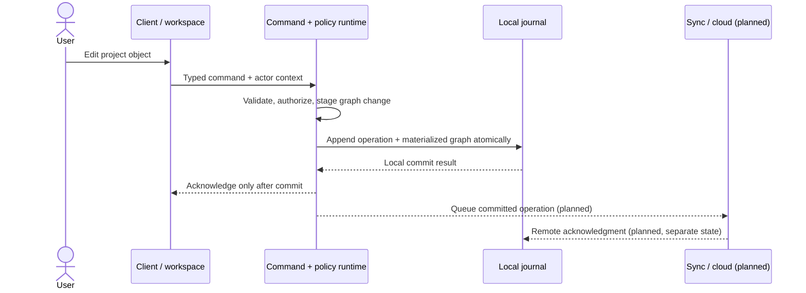

# Unified Creative Platform — architecture overview

- Status: target architecture with clearly marked implementation prototypes; not a production readiness claim.
- Product framing: [`../product/brief.md`](../product/brief.md).
- Requirements source: [`../../AGENTS.md`](../../AGENTS.md).

## Responsibilities and dependency direction

```text
Clients (desktop / web / native mobile)
  └─ shell + workspace modules
       └─ versioned typed command and module contracts
            └─ shared creative runtime
                 ├─ project graph and command reducer
                 ├─ local journal, snapshots, and recovery
                 ├─ immutable asset store
                 ├─ permissions and capability policy
                 └─ renderer / media interfaces
                      └─ sync and cloud services (planned)
```

| Boundary | Responsibility | Repository state |
|---|---|---|
| Client shell | Navigation, tabs, panels, account/project context, comments, notifications, and collaboration chrome. It does not render a professional canvas as a large DOM tree. | Not implemented. |
| Workspace module | Typed object definitions, commands, editor/inspector surfaces, renderers, importers, and exporters registered against stable runtime contracts. | Design is a goal, not implemented as a client. |
| Command boundary | Validate actor, project/target identity, causal order, command schema, preconditions, and capability before applying a state change. | Initial Rust command/reducer and local capability checks exist. |
| Shared runtime | Canonical graph semantics, replay/history, asset references, authorization interfaces, and rendering/media contracts. Workspace modules depend inward on these APIs; the core does not depend on a specific workspace. | Initial graph, command, permission, journal, asset, and history prototypes live in `crates/platform-runtime`. Renderer and stable module SDK are absent. |
| Local persistence | Commit an accepted operation before acknowledgment; keep local commit and remote replication as separate states. SQLite stores operations/materialized graph; immutable bytes live in a scoped content-addressed store. | WAL/FULL prototype and local asset store exist. Platform fault guarantees, encryption, and complete startup/recovery orchestration are open. |
| Sync/cloud | Replicate committed operations and assets with idempotency, deterministic per-object conflict policy, authorization, backpressure, and recoverable transfer state. | No sync or cloud service is implemented. Cloud-store selection remains subject to G02 evidence. |
| Render/media | Isolate high-volume canvas rendering, decode, encode, and risky jobs from the shell and journal process. | G11 has an isolated Skia CPU-raster/window spike and a separate WGPU compute probe; no product renderer, graph-backed scene evaluation, or media process boundary is implemented. See the [G11 evidence](../evidence/G11-renderer-architecture-spike.md) and proposed [ADR-004](../adr/ADR-004-renderer-and-gpu-boundary.md). |
| AI/extensions | Build plans and invoke the same command boundary under explicit, narrow capabilities; never get a direct canonical-state or unrestricted host access path. | Capability concepts exist in the runtime; planner, plugin sandbox, and service enforcement are future work. |

The Rust workspace is the current implementation vehicle, not yet an accepted long-term technology decision. ADR-001–003 remain proposed. The logical boundaries above should precede any split into services or processes.

## Primary edit and recovery path



On reopen, the runtime should validate the materialized graph and cursor, asset digests and lengths, then recover from a valid snapshot plus later operations when necessary. Recovery must not delete operations or source assets. The existing recovery prototype implements this local path; it does not establish process-isolation, power-loss, cloud, or cross-device guarantees.

## Trust boundaries

| Boundary | Threat / failure | Required control |
|---|---|---|
| Workspace/client → command runtime | Malformed commands, stale assumptions, forged actor/capability claims, accidental direct writes | Validate typed envelopes and graph preconditions; resolve capability from trusted command registration; persist only through the shared command path. |
| Local runtime → filesystem/database | Disk full, interrupted write, database or materialized-view corruption, local device exposure | Transactional commit, explicit failure before acknowledgment, checksums and recovery, scoped asset paths, and an encrypted-at-rest decision before production use. |
| Imported project or asset → parser/runtime | Malicious or malformed input, path traversal, resource exhaustion, unsupported versions | Treat imported bytes as untrusted; use bounded parsing and content/path validation, preserve originals, report unsupported versions, and add fuzz/compatibility coverage before release. |
| Tenant/project → asset storage | Cross-tenant identity or existence leakage | Derive scope from authenticated policy; do not globally deduplicate across protected scopes. Current local store scopes its object paths; server enforcement is not implemented. |
| Client/offline cache → sync service | Reordered, duplicated, delayed, or unauthorized remote operations | Authenticate and reauthorize at service boundary; use idempotent operations, deterministic ordering/merge rules, retries with bounds, and distinct local/remote durability status. Sync is not implemented. |
| AI/plugin → project | Prompt/model/tool misuse, overbroad access, bypass of validation or policy | No database access; narrow capabilities; preview/approval where required; same validated commands and audit attribution. Planner and sandbox are not implemented. |
| Workspace process → shell/journal | Decoder, renderer, or plugin crash taking down unrelated work or losing accepted edits | Isolate risky workers and keep durable journal ownership independent of workspace processes. Process topology is future work. |

## Failure behavior

- A local commit failure is an edit failure: do not acknowledge it as durable; the client must roll back an optimistic preview or show it as uncommitted.
- A remote outage must not erase or block already committed local work. The UI must not imply remote durability from a local commit.
- A corrupt materialized view is diagnostic and repairable only from validated history, snapshots, and available immutable assets. If no valid base exists, fail safely and retain evidence.
- Missing or corrupt assets must be identified by content identity and produce a recoverable diagnostic; never silently substitute bytes.
- Unsupported schema or command versions must fail visibly or use an explicit tested migration. Unknown node extensions are preserved where the graph contract permits it.
- Untrusted media/import parsing must be isolated and resource-bounded before broad format support is shipped.

## Contracts and references

- [Project graph v1](project-graph.md) and [`schemas/project-v1.schema.json`](../../schemas/project-v1.schema.json)
- [Typed command model v1](command-model.md) and [`schemas/command-envelope-v1.schema.json`](../../schemas/command-envelope-v1.schema.json)
- [Permissions](permissions.md) and [`schemas/capabilities-v1.schema.json`](../../schemas/capabilities-v1.schema.json)
- [Local journal, assets, and history](local-journal-and-assets.md), [ADR index](../adr/README.md), and [G06 evidence](../evidence/G06-history-recovery.md)
- [Portable project bundle v1 contract and runtime](portable-project-format.md) and [`schemas/project-manifest-v1.schema.json`](../../schemas/project-manifest-v1.schema.json)
- [Dependency record](../dependencies.md) and [goal/dependency map](../../goals/README.md)

## Current implementation limits

The checked-in code is an early local Rust prototype. It has a synthetic graph fixture; typed local commands; a SQLite journal; a scoped content-addressed asset store; an initial capability policy; local snapshots, named versions, and recovery; directory-form project-bundle export, verification, and import; and an isolated G11 renderer experiment. It has no end-user client, cloud sync/store, product renderer, media pipeline, graph-schema migration framework, or release-platform crash/restore evidence. The corresponding goals remain planned, and the ADRs remain proposed. See the goal map and per-goal evidence before relying on any prototype as a product guarantee.
